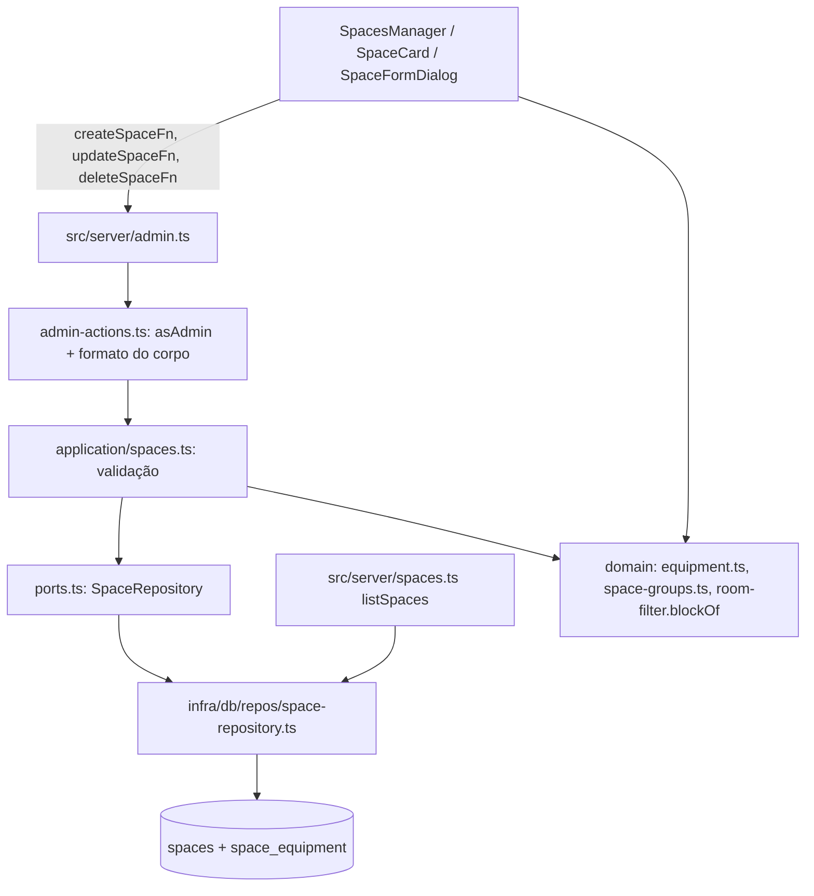

# Administração de espaços: design

**Spec**: `.specs/features/admin-espacos/spec.md`
**Status**: Approved

---

## Architecture Overview

A feature segue as camadas atuais: domínio puro (catálogo de equipamentos, rótulos, agrupamento), serviço de aplicação (validação), repositório Drizzle (gravação atômica), ações administrativas (papel `admin`) e componentes React. A agenda ganha os equipamentos só na resposta de `listSpaces`.



### Abordagens consideradas (modelo dos equipamentos)

| Abordagem | Prós | Contras |
| --------- | ---- | ------- |
| **A. Tabela `space_equipment` (espaço, tipo, quantidade) + catálogo no domínio** (escolhida) | Novo tipo = uma linha no catálogo, sem migração; "não informado" = ausência de linha, sem valor mágico; a mesma forma (recurso, tipo, quantidade) serve depois a veículos e computadores da biblioteca | Leitura com duas consultas; gravação precisa ser atômica (já existe `runAtomically`) |
| B. Colunas em `spaces` (`projector`, `computers`, `sound`) | Uma consulta; tipos fortes no banco | Cada tipo novo exige migração e mudança em todas as camadas |
| C. Coluna JSON em `spaces` | Flexível, uma consulta | Sem integridade no banco; consultas por equipamento ficam difíceis no D1 |

A abordagem A atende ao pedido de modelo extensível com o menor custo por tipo novo. A aprovação veio do pedido do orquestrador (decida no design justificando); não houve rodada interativa com o usuário.

---

## Code Reuse Analysis

### Existing Components to Leverage

| Component | Location | How to Use |
| --------- | -------- | ---------- |
| `blockOf` | `src/domain/room-filter.ts` | Bloco do espaço no agrupamento |
| Regra de andar | `src/components/agenda/room-selector.tsx:108` | Copiada para `floorOf` no domínio (não editamos o seletor agora) |
| `matchesRoomSearch` | `src/components/agenda/room-search.ts` | Busca da lista, igual à agenda |
| `runAtomically` | `src/infra/db/atomic.ts` | Troca atômica de nome, capacidade, observações e equipamentos |
| `asAdmin`, `record`, `text`, `fromResult`, `reject` | `src/server/admin-actions.ts` | Autorização e formato do corpo |
| `runAdminAction`, `fieldError`, `generalError`, `useFocusInvalidField` | `src/components/admin/use-admin-action.ts` | Erros no campo e foco |
| `FieldError` | `src/components/admin/field-error.tsx` | Mensagem ligada ao campo |
| `AlertDialog*` | `src/components/ui/alert-dialog.tsx` | Confirmação de exclusão |
| `Dialog` (radix) | padrão de `room-selector.tsx` | Diálogo de criar/editar |
| `Tag`, `ChoiceCard` | `src/components/ds.tsx` | Rótulos de equipamento e escolha sim/não/não informado |
| `Card`, `Notice`, `PageHeader` | `src/components/page.tsx` | Layout e estados |
| `Textarea`, `Input`, `Label`, `Button` | `src/components/ui/*` | Campos |

### Integration Points

| System | Integration Method |
| ------ | ------------------ |
| Agenda (`src/routes/index.tsx` via `listSpaces`) | `listSpaces` passa a chamar `listWithEquipment()`; `equipment` é opcional no tipo, nada na tela muda |
| Banco | Migração `0009_*` gerada por `bun run db:generate`: `ALTER TABLE spaces ADD equipment_notes`, `CREATE TABLE space_equipment` com FK `ON DELETE CASCADE` |
| D1 | Mesma pasta `drizzle/` (`migrations_dir` em `wrangler.jsonc`); teste `RUN_D1_TESTS=1` cobre migração e gravação no workerd local |

---

## Components

### Catálogo de equipamentos

- **Purpose**: Tipos de equipamento, medida (presença ou contagem) e rótulos de cada estado.
- **Location**: `src/domain/equipment.ts`
- **Interfaces**:
  - `EQUIPMENT: readonly { kind; label; measure: "presence" | "count" }[]`
  - `type EquipmentKind = "projetor" | "computadores" | "som"`
  - `type SpaceEquipment = { items: Partial<Record<EquipmentKind, number>>; notes: string | null }`
  - `isEquipmentKind(value: string): value is EquipmentKind`
  - `describeEquipment(kind, quantity: number | undefined): { text: string; known: boolean }`
- **Dependencies**: nenhuma
- **Reuses**: nada

### Agrupamento por bloco e andar

- **Purpose**: Agrupar espaços como o seletor de sala, com ordem natural.
- **Location**: `src/domain/space-groups.ts`
- **Interfaces**:
  - `floorOf(name: string): string | null`
  - `groupSpaces<T extends { name: string }>(spaces: readonly T[]): { label: string; floors: { label: string; spaces: T[] }[] }[]`
- **Reuses**: `blockOf`

### Repositório de espaços

- **Purpose**: Ler e gravar espaços com equipamentos; excluir só espaço sem uso.
- **Location**: `src/infra/db/repos/space-repository.ts` (porta em `src/application/ports.ts`)
- **Interfaces**:
  - `list(): Promise<Space[]>` (sem mudança)
  - `listWithEquipment(): Promise<Space[]>` (duas consultas, junção em memória, ignora tipos fora do catálogo)
  - `create(input: SpaceWrite): Promise<Space>` (com `equipment`, atômico)
  - `update(id, input: SpaceWrite): Promise<Space | null>` (com `equipment`, atômico; `equipment.items` e `equipment.notes` são independentes e o que faltar fica como está; sem `equipment`, só nome e capacidade)
  - `remove(id): Promise<"removed" | "in_use" | "not_found">` (DELETE condicional com `NOT EXISTS` em `occupations`, `room_mappings` e `import_rows`, no mesmo lote que apaga os equipamentos)
- **Reuses**: `runAtomically`

### Serviço de espaços

- **Purpose**: Validar nome, capacidade, equipamentos e observações; traduzir recusas.
- **Location**: `src/application/spaces.ts`
- **Interfaces**:
  - `SpaceInput = { name; capacity; equipment?: { items?: Record<string, number | string | null>; notes?: string | null } }` (na edição, `items` ou `notes` ausente mantém o gravado)
  - `listWithEquipment()`, `create(input)`, `update(id, input)`, `remove(id): Result<null>`

### Ações administrativas

- **Purpose**: Exigir `admin`, checar o formato do corpo e chamar o serviço.
- **Location**: `src/server/admin-actions.ts` (+ `src/server/admin.ts`)
- **Interfaces**: `createSpace`, `updateSpace` aceitam `equipment` (objeto) e `notes` (texto ou nulo), ambos opcionais e independentes (na edição, o ausente mantém o gravado); `listAdminSpaces` devolve com equipamentos; `deleteSpace(deps, req, { id })`; `deleteSpaceFn`.

### SpaceCard

- **Purpose**: Cartão do espaço com capacidade, rótulos de equipamento, observações, "Editar" e "Excluir" com confirmação.
- **Location**: `src/components/admin/space-card.tsx`
- **Reuses**: `Card`, `Tag`, `AlertDialog*`, `describeEquipment`, `runAdminAction`

### SpaceFormDialog

- **Purpose**: Diálogo de criar/editar com campos de identificação e equipamentos e erros no campo.
- **Location**: `src/components/admin/space-form-dialog.tsx`
- **Reuses**: `Dialog` (radix), `ChoiceCard`, `Input`, `Textarea`, `FieldError`, `useFocusInvalidField`

### SpacesManager

- **Purpose**: Barra com busca, contador e "Novo espaço"; grupos por bloco e andar; estados vazio e sem resultado; anúncio "Espaço salvo." / "Espaço excluído.".
- **Location**: `src/components/admin/spaces-manager.tsx`
- **Reuses**: `groupSpaces`, `matchesRoomSearch`, `SpaceCard`, `SpaceFormDialog`

### Rota `/admin/espacos`

- **Purpose**: Erro com "Tentar de novo" e estado de carregamento.
- **Location**: `src/routes/admin.espacos.tsx`

---

## Data Models

```typescript
// src/domain/equipment.ts
type EquipmentKind = "projetor" | "computadores" | "som";
/** Itens ausentes = não informado; 0 = não tem; presença usa 1 = tem. */
type SpaceEquipment = { items: Partial<Record<EquipmentKind, number>>; notes: string | null };

// src/domain/space.ts
type Space = { id: string; name: string; capacity: number | null; equipment?: SpaceEquipment };
```

```sql
ALTER TABLE spaces ADD equipment_notes text;
CREATE TABLE space_equipment (
  space_id text NOT NULL REFERENCES spaces(id) ON DELETE CASCADE,
  kind text NOT NULL,
  quantity integer NOT NULL,
  PRIMARY KEY (space_id, kind)
);
```

**Relationships**: `space_equipment.space_id` → `spaces.id` (1:N). A forma (recurso, tipo, quantidade) é a que a feature `motoristas-e-veiculos` pode generalizar depois; esta feature não cria a tabela genérica.

---

## Error Handling Strategy

| Error Scenario | Handling | User Impact |
| -------------- | -------- | ----------- |
| Campo inválido (nome, capacidade, computadores, projetor, som, observações) | Serviço devolve `validation` com `field`; ação responde 400 | Mensagem abaixo do campo, foco nele, diálogo aberto |
| Nome duplicado (inclusive corrida no UNIQUE) | `conflict` 409 em `name` (lógica atual) | Mensagem no campo nome |
| Tipo de equipamento desconhecido | `validation` 400 sem campo | Alerta no topo do diálogo |
| Corpo malformado | 400 "Requisição inválida." | Alerta no topo |
| Sem sessão / sem papel | 401 / 403; `runAdminAction` vira mensagem de sessão | Alerta no topo |
| Falha no meio da gravação | `runAtomically` desfaz tudo; erro propaga | Alerta genérico; nada parcial gravado |
| Excluir espaço em uso | `remove` → `in_use` → 409 | Alerta na confirmação |
| Excluir espaço inexistente | `not_found` → 404 | Alerta na confirmação |
| Carga da lista falha | `errorComponent` da rota | "Não foi possível carregar os espaços." + "Tentar de novo" |

---

## Risks & Concerns

| Concern | Location (file:line) | Impact | Mitigation |
| ------- | -------------------- | ------ | ---------- |
| `parseText` recusa quebra de linha | `src/application/validation.ts:17` | Observações com várias linhas seriam recusadas | Validador próprio de observações que aceita `\n`, `\r` e `\t` |
| Regra de andar duplicada (seletor e domínio) | `src/components/agenda/room-selector.tsx:108` | As duas telas podem divergir | `floorOf` copia a regra; unificar depois do merge (próximo passo na spec) |
| `mock.module("#/server/admin")` é global no bun | `src/components/admin/admin-managers.test.tsx:25` | Outro arquivo mockando o mesmo módulo pode vazar entre testes | Testes da nova tela ficam no mesmo arquivo, com respostas controláveis |
| Exclusão concorrente com nova reserva | `src/infra/db/schema.ts:184` | Reserva criada no meio da exclusão | DELETE condicional numa instrução; FK de `occupations` barra a inserção órfã (D1 aplica FKs; local liga `PRAGMA foreign_keys`) |
| `import_rows.space_id` sem FK | `src/infra/db/schema.ts:142` | Apagar espaço citado por lote em rascunho quebraria a aplicação | `remove` checa `import_rows` também |
| Teste existente do formulário antigo | `src/components/admin/admin-managers.test.tsx:284` | O formulário mudou para dentro do diálogo | Mesmo teste e mesmas asserções, com a abertura do diálogo antes (registrado como desvio) |

---

## Tech Decisions

| Decision | Choice | Rationale |
| -------- | ------ | --------- |
| Leitura com equipamentos | Método novo `listWithEquipment()`; `list()` intacto | 10 consumidores usam `list()`; não mudam nem pagam a segunda consulta |
| Retorno de `create`/`update` | Inclui `equipment` só quando o pedido trouxe equipamentos | Mantém o formato antigo para quem não envia equipamentos |
| Edição sem equipamentos | Mantém o gravado | Chamadas antigas (importação cria espaço só com nome) seguem válidas |
| Valores de presença no fio | `1`, `0` ou `null`/`""` | Mesmo número que vai ao banco; sem texto mágico |
| Diálogo no celular | Encostado na base da tela, `max-h-[90svh]`, rolagem interna e rodapé fixo | Cabe em 360 px com teclado aberto |
| Testes da tela | Em `admin-managers.test.tsx` | Evita dois `mock.module` do mesmo módulo |

Decisão de projeto registrada em `.specs/STATE.md` como AD-003 (equipamentos como linhas tipo + quantidade, catálogo no domínio).
