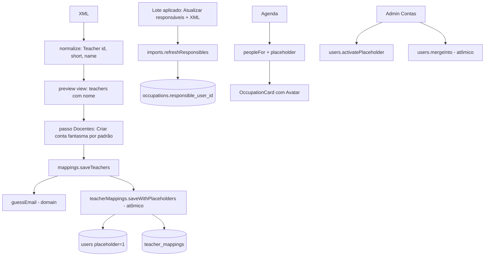

# Docentes do XML: desenho

**Spec**: `.specs/features/docentes-do-xml/spec.md`
**Status**: Approved (escolha delegada pelo usuário em 2026-11-04)
**Decisões de projeto**: AD-001 e AD-002 em `.specs/STATE.md`

---

## Architecture Overview

A conta fantasma é uma conta normal (`users`) com a coluna nova `placeholder = true`. Assim ela entra em todo o fluxo existente (vínculo de docente, responsável da ocupação, `peopleFor`, cancelamento) sem caminho paralelo. O login recusa fantasmas. As fantasmas nascem ao salvar o passo de docentes, numa única gravação atômica de contas + vínculos.



Abordagens consideradas:

1. **Coluna `placeholder` em `users` (escolhida).** Reusa todo o modelo; uma migração pequena.
2. Tabela separada de docentes do XML. Exigiria responsável apontando para duas tabelas; reescreve cancelamento e agenda.
3. Conta inativa (`active = false`) como fantasma. `active` já significa "desativada pelo admin" e é filtrada em `saveTeachers` e `suggestTeachers`; misturar os dois sentidos quebra regras atuais.

---

## Code Reuse Analysis

### Existing Components to Leverage

| Component | Location | How to Use |
| --------- | -------- | ---------- |
| `readSection` dos docentes | `src/import-asc/normalize.ts:213` | Acrescentar `name` (com fallback `firstname lastname`) |
| `runAtomically` | `src/infra/db/atomic.ts` | Contas + vínculos numa transação (bun:sqlite) ou `batch` (D1) |
| `saveMany` de vínculos | `src/infra/db/repos/mapping-repositories.ts:46` | Mesmo upsert, agora dentro da gravação atômica |
| `responsibleOf` | `src/application/import-plan.ts:80` | Mesma regra de responsável ao atualizar o semestre |
| `findBatchByHash`, `latestAppliedBatchId` | `src/application/ports.ts:165,200` | Validar que o XML é o da versão aplicada |
| `peopleFor`, `AgendaPerson` | `src/application/bookings.ts:143` | Acrescentar `placeholder` |
| `Avatar` | `src/components/avatar.tsx` | Avatar no cartão (`xs`) |
| `createUsersService` | `src/application/users.ts` | Ativar e fundir |
| `hasher.hash`, `getDummyHash` | `src/application/auth.ts` | Hash aleatório da fantasma; login uniforme |

### Integration Points

| System | Integration Method |
| ------ | ------------------ |
| Banco | Migração `0008`: `ALTER TABLE users ADD placeholder integer NOT NULL DEFAULT 0` (bun:sqlite e D1) |
| Import UI | `mapping-steps.tsx`: opção "Criar conta fantasma" no seletor de cada docente |
| Lote | `importar.lotes.$id.tsx`: botão "Atualizar responsáveis" com envio do XML |
| Admin | `accounts-manager.tsx`: selo "Não ativada", filtro, ações Ativar e Fundir |

---

## Components

### Migração e modelo

- **Location**: `src/infra/db/schema.ts`, `drizzle/0008_*.sql`, `src/domain/user.ts`, `src/infra/db/repos/user-repository.ts`
- **Interfaces**: `User.placeholder: boolean`; leitura e escrita no repositório.

### Login recusa fantasma

- **Location**: `src/application/auth.ts:103`
- **Interfaces**: `if (!record?.active || record.placeholder || !passwordOk)` → mesma falha de credencial, mesmo custo de hash.

### Nome do docente no XML

- **Location**: `src/import-asc/normalize.ts`, `src/domain/timetable.ts`, `src/server/import-preview-view.ts`
- **Interfaces**: `Teacher = { id; short; name }`; DTO da prévia leva `name`. E-mail, celular, gênero e cor continuam ignorados (teste garante).

### `guessEmail`

- **Location**: `src/domain/guess-email.ts`
- **Interfaces**: `guessEmail(name: string, fallbackId: string, taken: ReadonlySet<string>): string` - sem acento, minúsculas, `primeiro.ultimo@ifsc.edu.br`, sufixo `2`, `3`… em colisão.

### Gravação atômica de fantasmas + vínculos

- **Location**: `src/infra/db/repos/mapping-repositories.ts` + porta `TeacherMappingRepository.saveWithPlaceholders`
- **Interfaces**: `saveWithPlaceholders(placeholders: NewPlaceholder[], mappings: TeacherMapping[], at: string): Promise<void>`.

### `mappings.saveTeachers` e `suggestTeachers`

- **Location**: `src/application/import-mappings.ts`
- **Interfaces**:
  - Entrada ganha `createPlaceholder?: { name: string }` por item (exclusivo com `userId`).
  - `suggestTeachers` devolve `name` e `defaultAction: "fantasma" | "sugestao" | "salvo"`.
  - Antes de criar, procura fantasma existente com o mesmo código (reimportação reaproveita, DOC-04).

### `imports.refreshResponsibles`

- **Location**: `src/application/import-apply.ts` + repo `ImportRepository.setResponsibles`
- **Interfaces**: `refreshResponsibles({ semesterId, fileHash, preview, actorId }): Promise<Result<{ changed: number; withoutResponsible: number }>>`
- Recusa se `fileHash` ≠ hash do último lote aplicado do semestre. Calcula `lessonId → userId | null` com `responsibleOf` e os vínculos atuais; o repo faz um `UPDATE … WHERE source='import' AND status='ativa' AND lesson_id=? AND starts_at` dentro do semestre, em blocos atômicos de 50 aulas. Idempotente.

### Avatar na agenda

- **Location**: `src/components/agenda/agenda-blocks.tsx` (`OccupationCard`), `occupation-details.tsx`
- **Interfaces**: `AgendaPerson = { name; code; placeholder }`; avatar `xs` sempre que `person !== null`; selo "conta não ativada" nos detalhes.

### Ativar e fundir

- **Location**: `src/application/users.ts`, `src/infra/db/repos/user-repository.ts`, `src/server/admin-actions.ts`, `src/server/admin.ts`, `src/components/admin/accounts-manager.tsx`
- **Interfaces**:
  - `activatePlaceholder(actor, id, { email, password })` → valida e-mail único e senha (regras atuais), grava hash, `placeholder = false`.
  - `mergePlaceholder(actor, id, targetId)` → recusa alvo fantasma ou inativo; repo `mergeInto(fromId, toId)` atômico: `occupations.responsible_user_id`, `occupations.created_by`, `teacher_mappings.user_id`, apaga sessões e a conta.

---

## Data Models

```typescript
type User = { id; email; name; code: string | null; roles: Role[]; active: boolean; placeholder: boolean };

type NewPlaceholder = { id: string; email: string; name: string; code: string | null; passwordHash: string };

type TeacherMappingInput = TeacherMapping & { createPlaceholder?: { name: string } };
```

---

## Error Handling Strategy

| Error Scenario | Handling | User Impact |
| -------------- | -------- | ----------- |
| Falha ao gravar fantasmas | `runAtomically` desfaz tudo | "Não foi possível salvar os vínculos" e nada muda |
| XML diferente em "Atualizar responsáveis" | `fail("validation")` antes de qualquer escrita | "Envie o mesmo arquivo da versão aplicada" |
| Falha no meio dos blocos de atualização | Blocos já gravados ficam; ação é idempotente | Repetir a ação conclui |
| E-mail em uso ao ativar | `fail("conflict")` | "Este e-mail já está em uso" |
| Fundir em fantasma/inativa | `fail("validation")` | Mensagem explicando o alvo inválido |
| Login de fantasma | Mesma falha de credencial | "E-mail ou senha incorretos" |

---

## Risks & Concerns

| Concern | Location (file:line) | Impact | Mitigation |
| ------- | -------------------- | ------ | ---------- |
| Ocupações de versões antigas com outro `batch_id` | `src/infra/db/schema.ts:189` | Atualizar só pelo lote deixaria aulas "inalteradas" de fora | Atualizar por `lesson_id` + intervalo do semestre, não por `batch_id` |
| `lesson_id` muda entre exportações do aSc | `src/application/import-mappings.ts:66` (mesmo problema das salas) | Aulas antigas sem correspondência | Exigir o XML da versão aplicada (mesmo hash) |
| `peopleFor` carrega todas as contas | `src/application/bookings.ts:209` | Com +43 contas, ainda trivial | Aceito; revisar se passar de alguns milhares |
| Mudança de regra de privacidade | `docs/specs/2026-11-01-reserva-espacos-design.md:146` | Spec original desatualizada | Atualizar a seção 7.2 citando AD-001 na mesma tarefa do normalize |
| `exactOptionalPropertyTypes` | `tsconfig.json` | `createPlaceholder?:` exige `| undefined` explícito em chamadas | Seguir o padrão já usado no repo |

---

## Tech Decisions

| Decision | Choice | Rationale |
| -------- | ------ | --------- |
| Momento de criar fantasma | Ao salvar o passo de docentes | A aplicação do lote é em vários passos; aqui a gravação é atômica |
| Senha da fantasma | Hash de 32 bytes aleatórios descartados | `password_hash` é obrigatório; ninguém conhece a senha |
| Fundir apaga a fantasma | Sim | Evita duas contas para a mesma pessoa |
