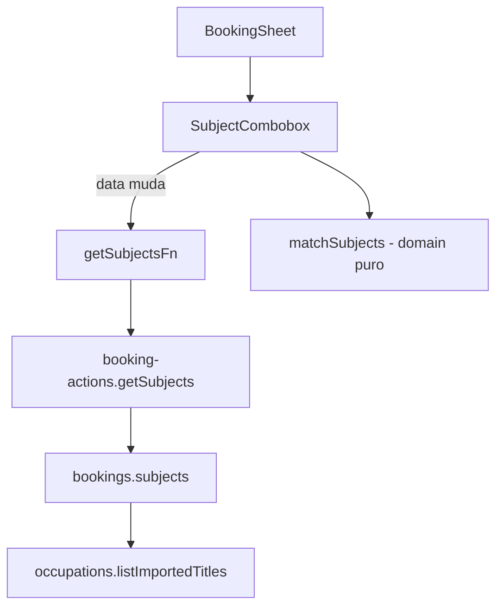

# Matéria na reserva: desenho

**Spec**: `.specs/features/materia-na-reserva/spec.md`
**Status**: Approved (escolha delegada pelo usuário em 2026-11-04)

---

## Architecture Overview

O catálogo de matérias são os títulos distintos das ocupações importadas ativas do semestre da data. O servidor devolve dois grupos já separados e sem repetição; o cliente só filtra pelo texto. O campo `purpose` do `BookingSheet` continua sendo uma string: só muda o controle de entrada.

Abordagens consideradas:

1. **Títulos das ocupações importadas (escolhida).** Zero migração; o texto é exatamente o que aparece na agenda.
2. Tabela `subjects` gravada no import. Precisaria de reimportação para popular e não acrescenta nada à lista.
3. Ler a prévia guardada do lote. O lote não guarda a prévia.

---

## Code Reuse Analysis

### Existing Components to Leverage

| Component | Location | How to Use |
| --------- | -------- | ---------- |
| `blocksFor` (escolha do semestre) | `src/application/bookings.ts:173` | Mesma regra: semestre que contém a data, senão o mais recente |
| `Popover`, `Input` | `src/components/ui/` | Base do combobox (mesmo padrão do seletor de sala) |
| `normalize` sem acento | `src/components/agenda/room-selector.tsx` (não commitado) | Reimplementar em `src/domain/text-match.ts` e não tocar no seletor |
| Validação de `purpose` | `src/application/bookings.ts` (`createBooking`) | Limite de tamanho e mensagem atuais |

---

## Components

### `occupations.listImportedTitles`

- **Location**: `src/infra/db/repos/occupation-repository.ts` + porta
- **Interfaces**: `listImportedTitles(from: string, to: string): Promise<Array<{ title: string; responsibleUserId: string | null }>>` - `SELECT DISTINCT title, responsible_user_id … WHERE source='import' AND status='ativa'`.

### `bookings.subjects`

- **Location**: `src/application/bookings.ts`
- **Interfaces**: `subjects(viewer: User, input: { date: string }): Promise<Result<{ mine: string[]; all: string[] }>>` - `all` sem os itens de `mine`, ambos em ordem `localeCompare("pt-BR")`. Visitante recebe `forbidden`.

### `matchSubjects`

- **Location**: `src/domain/text-match.ts`
- **Interfaces**: `normalizeText(s: string): string`; `matchSubjects(groups, query): { mine; all; exact: boolean }`.

### `SubjectCombobox`

- **Location**: `src/components/agenda/subject-combobox.tsx`
- **Interfaces**: `{ value: string; onChange(value: string): void; date: string; loadFn?; id; invalid? }` - grupos, busca, opção "Usar “texto” como título", alvos de 44 px, largura total no celular.

### Integração no `BookingSheet`

- **Location**: `src/components/agenda/booking-sheet.tsx`
- Troca o input de `purpose` pelo combobox; rótulo "Matéria ou título"; mensagem "Informe a matéria ou o título" quando vazio.

---

## Error Handling Strategy

| Error Scenario | Handling | User Impact |
| -------------- | -------- | ----------- |
| Falha ao carregar matérias | Combobox vira entrada livre | "Não foi possível carregar as matérias" e o campo segue funcionando |
| Título vazio | Validação no cliente e no servidor | "Informe a matéria ou o título" |
| Título longo | Validação atual | Mensagem atual |

---

## Risks & Concerns

| Concern | Location (file:line) | Impact | Mitigation |
| ------- | -------------------- | ------ | ---------- |
| "Minhas matérias" vazia sem responsável | depende de `docentes-do-xml` | Grupo escondido para quase todos hoje | Implementar depois de `docentes-do-xml`; AC 5 já trata o vazio |
| Testes do `BookingSheet` que digitam no input | `test/components/` | Quebram com o novo controle | Atualizar no mesmo task da integração |

---

## Tech Decisions

| Decision | Choice | Rationale |
| -------- | ------ | --------- |
| Catálogo | Títulos importados, sem tabela | Sem migração; igual ao que a agenda mostra |
| Carga | Uma chamada quando a data muda de semestre | Lista pequena (142 itens) |
