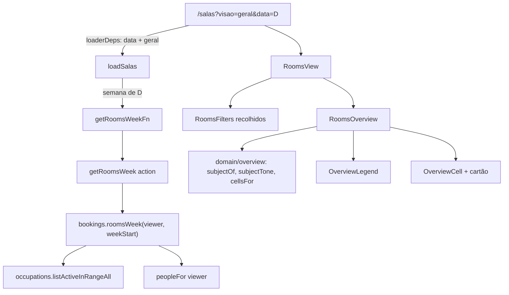

# Visão geral: design

**Spec**: `.specs/features/visao-geral/spec.md`
**Status**: Approved (o usuário pediu a implementação em 2026-11-04 e delegou as escolhas)

---

## Architecture Overview

A visão geral é a terceira visão de `/salas` (`visao=geral`). O servidor devolve a semana inteira de todas as salas numa chamada (`roomsWeek`), com os blocos do semestre de cada dia. O domínio puro decide matéria, cor e quais ocupações caem em cada bloco; os componentes só desenham.



---

## Code Reuse Analysis

### Existing Components to Leverage

| Component | Location | How to Use |
| --------- | -------- | ---------- |
| `roomsDay`, `buildDay`, `toItem`, `peopleFor`, `blocksFor` | `src/application/bookings.ts` | `roomsWeek` segue o mesmo formato: uma consulta, ordem natural, só semestres que cobrem cada dia |
| `listActiveInRangeAll` | `src/infra/db/repos/occupation-repository.ts` | Consulta da semana (segunda 00:00 a sábado 00:00) |
| `getRoomsDay` / `getRoomsDayFn` | `src/server/booking-actions.ts`, `src/server/booking-fns.ts` | Mesmo padrão para `getRoomsWeek` / `getRoomsWeekFn` |
| `loadSalas`, `validateSalasSearch` | `src/routes/salas.tsx` | Aceitar `visao=geral`; carregar a semana quando for a visão geral |
| `filterRooms`, `blockOf`, `blocksOf` | `src/domain/room-filter.ts` | Mesmos filtros de bloco, capacidade e busca sobre as salas da semana |
| `avatarTone` (hash estável) | `src/components/avatar.tsx` | Mesma ideia de hash para a cor da matéria |
| `Avatar` | `src/components/avatar.tsx` | Responsável no cartão (só logado) |
| `Popover` | `src/components/ui/popover.tsx` | Botão "Filtros · n" e cartão no toque do celular |
| `useCompact` | `src/components/rooms/rooms-view.tsx` | Decide celular (< 768 px) |
| `addDays`, `weekdayOf` | `src/domain/calendar.ts` | Segunda-feira da semana e os cinco dias |

### Integration Points

| System | Integration Method |
| ------ | ------------------ |
| Rota `/salas` | `visao=geral` entra em `SalasSearch`; `loaderDeps` passa a `{ data, geral }`, então trocar entre "Colunas" e "Livres" continua sem ir ao servidor |
| Agenda | Clique num quadradinho navega para `/` com `{ espaco, data }`, como o nome da sala em "Colunas" |
| Banco | Nenhuma mudança de esquema |

---

## Components

### `domain/overview`

- **Purpose**: Regras puras da grade: matéria, cor e ocupações por bloco.
- **Location**: `src/domain/overview.ts`
- **Interfaces**:
  - `subjectOf(title: string): string` - parte antes de " — "; sem separador, o título inteiro (aparado).
  - `subjectTone(subject: string): number` - índice estável em `SUBJECT_PALETTE`.
  - `SUBJECT_PALETTE: readonly { light: string; dark: string }[]` - cores hex; `RESERVA_TONE` para avulsas.
  - `contrastRatio(a: string, b: string): number` - WCAG, para o teste de 3:1.
  - `cellsFor(items, blocks): Cell[]` - por bloco, as ocupações que o cruzam (`start < block.end && end > block.start`), cada uma com `partial` quando não cobre o bloco inteiro.
  - `weekOf(date: string): string[]` - segunda a sexta da semana da data.
- **Dependencies**: nenhuma.
- **Reuses**: `addDays`, `weekdayOf`.

### `bookings.roomsWeek`

- **Purpose**: Semana de todas as salas, numa consulta de ocupações.
- **Location**: `src/application/bookings.ts`
- **Interfaces**:
  - `roomsWeek(viewer: User | null, input: { weekStart: string }): Promise<Result<RoomsWeek>>` - `weekStart` obrigatoriamente segunda-feira.
- **Dependencies**: `occupations`, `spaces`, `semesters`, `users`.
- **Reuses**: `toItem`, `peopleFor`, `blocksFor` restrito aos semestres que cobrem cada dia.

### `getRoomsWeek` / `getRoomsWeekFn`

- **Purpose**: Expor `roomsWeek` com sessão opcional.
- **Location**: `src/server/booking-actions.ts`, `src/server/booking-fns.ts`
- **Reuses**: `getRoomsDay`.

### Rota `/salas`

- **Purpose**: Aceitar `visao=geral` e carregar a semana certa.
- **Location**: `src/routes/salas.tsx`
- **Interfaces**: `loadSalas(data, session, fetchDay, now, { geral, fetchWeek })` devolve também `roomsWeek` quando `geral`.

### `RoomsFilters` (reorganizado)

- **Purpose**: Tela limpa: só a busca de sala fica sempre visível ao lado da data; bloco, capacidade e "Só livres" vão para o botão "Filtros · n".
- **Location**: `src/components/rooms/rooms-filters.tsx`
- **Interfaces**: prop `view: "colunas" | "livres" | "geral"` decide o que entra: a janela de horário fica visível na visão "Livres" (é a pergunta da visão) e dentro de "Filtros" em "Colunas"; a visão geral não tem janela nem "Só livres".

### `RoomsOverview`

- **Purpose**: Grade salas × (dias × blocos) com legenda; no celular, um dia por vez com abas.
- **Location**: `src/components/rooms/rooms-overview.tsx`
- **Dependencies**: `domain/overview`, `OverviewLegend`, `OverviewCell`.

### `OverviewLegend`

- **Purpose**: Matérias da semana com sua cor; clique destaca, segundo clique remove.
- **Location**: `src/components/rooms/overview-legend.tsx`

### `OverviewCell`

- **Purpose**: Um quadradinho: vazio com contorno, cheio com a cor, faixas quando há mais de uma ocupação, canto recortado quando parcial. Hover ou foco escala (≤ 150 ms, sem escala com movimento reduzido) e mostra o cartão; clique navega (desktop) ou abre o cartão (celular).
- **Location**: `src/components/rooms/overview-cell.tsx`

---

## Data Models

```typescript
type OverviewBlock = { label: string; short: string; start: string; end: string };

type RoomsWeek = {
  weekStart: string; // segunda-feira
  now: string;
  days: Array<{ date: string; blocks: OverviewBlock[] }>; // segunda a sexta
  rooms: Array<{
    space: { id: string; name: string; capacity: number | null };
    occupations: AgendaItem[]; // a semana toda da sala, com `date`
  }>;
};

type Cell = {
  block: OverviewBlock;
  items: Array<{ item: AgendaItem; partial: boolean }>;
};
```

---

## Error Handling Strategy

| Error Scenario | Handling | User Impact |
| -------------- | -------- | ----------- |
| `weekStart` inválido ou não segunda | `fail("validation")`, 400 | A rota sempre manda a segunda da data; não chega ao usuário |
| Falha do servidor | `loadSalas` devolve `error` | "Não foi possível carregar as salas" e "Tentar de novo" |
| Semana sem blocos | `days[].blocks` vazio | "Esta semana não tem blocos de horário" e atalho para "Colunas" |

---

## Risks & Concerns

| Concern | Location (file:line) | Impact | Mitigation |
| ------- | -------------------- | ------ | ---------- |
| Ocupação inteira no intervalo entre dois blocos não cruza nenhum bloco | `src/domain/overview.ts` (novo) | A aula some da grade | `cellsFor` devolve também `outside`; a linha da sala mostra um ponto de aviso com o cartão dessas ocupações |
| Payload da semana | `src/application/bookings.ts:316` | ~160 ocupações por semana hoje; cresce com reservas | Uma consulta só, sem campos extras; aceitável |
| `loaderDeps` mudou | `src/routes/salas.tsx:119` | Trocar visão poderia recarregar à toa | `geral` é booleano: só entrar ou sair da visão geral recarrega; teste cobre (lição L-010: afirmar o argumento enviado ao servidor) |

---

## Tech Decisions

| Decision | Choice | Rationale |
| -------- | ------ | --------- |
| Cor | Paleta fixa em hex no domínio, aplicada por `style` com variáveis CSS claro/escuro | O contraste de 3:1 vira teste unitário sobre os valores reais |
| Cartão | Elemento próprio posicionado, aberto por hover/foco; no celular, `Popover` | Não há Tooltip/HoverCard em `src/components/ui`; evita dependência nova |
| Janela de horário | Visível na visão "Livres", dentro de "Filtros" em "Colunas", ausente na visão geral | Refina GERAL-08 AC1: a janela é a pergunta da visão "Livres", não um filtro pouco usado |
