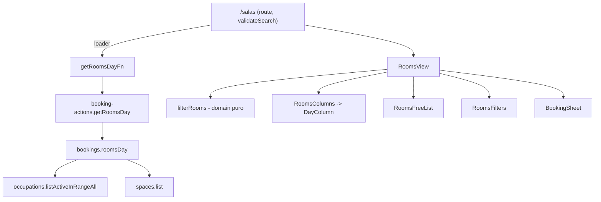

# Todas as salas: desenho

**Spec**: `docs/specs/features/todas-as-salas/spec.md`
**Status**: Approved (escolha delegada pelo usuário em 2026-11-04)

---

## Architecture Overview

O servidor devolve um `DayAgenda` por sala para um dia, numa só chamada e com uma só consulta de ocupações. Toda a filtragem (bloco, capacidade, busca, janela livre) roda no cliente, sobre esses dados, numa função pura de domínio. As duas visões reutilizam o que já existe: "Colunas" usa `DayColumn` (rascunho e botão direito inclusos), "Livres" usa a mesma função de filtro.



Abordagens consideradas:

1. **Uma chamada por dia, filtro no cliente (escolhida).** 21 salas × um dia são poucas dezenas de ocupações; trocar filtros e janela não toca o servidor (SALAS-09 AC 2).
2. Filtro no servidor. Cada mudança de filtro viraria uma chamada; sem ganho com 21 salas.
3. Reaproveitar `weekAgenda` uma vez por sala. 21 chamadas por troca de dia; viola SALAS-01 AC 2.

---

## Code Reuse Analysis

### Existing Components to Leverage

| Component | Location | How to Use |
| --------- | -------- | ---------- |
| `buildDay`, `toItem`, `peopleFor`, `blocksFor` | `src/application/bookings.ts` | Montar um `DayAgenda` por sala, com a mesma regra de nomes para visitante |
| `listActiveInRange` | `src/infra/db/repos/occupation-repository.ts:59` | Modelo da nova consulta sem filtro de sala |
| `DayColumn`, `useDraftGesture`, `SlotContextMenu` | `src/components/agenda/` | Coluna de cada sala com rascunho e botão direito |
| `makeScale`, `HourAxis`, `HourLines`, `NowLine` | `src/components/agenda/agenda-blocks.tsx` | Eixo de horas compartilhado |
| `BookingSheet` | `src/components/agenda/booking-sheet.tsx` | Nova reserva com `initialSlot` (sala, data, horário) |
| `validateAgendaSearch` | `src/routes/index.tsx` | Padrão de validação de search params |
| `freeIntervals` | `src/domain/availability.ts` | Livre por sala já vem calculado em `DayAgenda.free` |

### Integration Points

| System | Integration Method |
| ------ | ------------------ |
| Server functions | Novo `getRoomsDayFn` em `src/server/booking-fns.ts`, ação em `booking-actions.ts` |
| Navegação | Item "Salas" em `app-shell.tsx` (todos os papéis logados) e link "Todas as salas" na barra da agenda (visitante também) |
| Banco | Só leitura; sem migração |

---

## Components

### `occupations.listActiveInRangeAll`

- **Purpose**: ocupações ativas de todas as salas que cruzam `[from, to)`.
- **Location**: `src/infra/db/repos/occupation-repository.ts` + porta em `src/application/ports.ts`
- **Interfaces**: `listActiveInRangeAll(from: string, to: string): Promise<OccupationRecord[]>`, ordem `(spaceId, startsAt, id)`.
- **Reuses**: colunas e filtros de `listActiveInRange`.

### `bookings.roomsDay`

- **Purpose**: agenda de um dia para todas as salas.
- **Location**: `src/application/bookings.ts`
- **Interfaces**: `roomsDay(viewer: User | null, input: { date: string }): Promise<Result<RoomsDay>>`
- **Dependencies**: `occupations`, `spaces`, `semesters`, `users`.

### `filterRooms` e `blockOf`

- **Purpose**: regra pura dos filtros e da janela livre.
- **Location**: `src/domain/room-filter.ts`
- **Interfaces**:
  - `blockOf(name: string): string | null` - letra do bloco (`A-202` → `A`).
  - `filterRooms(rooms: RoomDay[], filter: RoomFilter, now: string): { rooms: RoomDay[]; hiddenNoCapacity: number }`
  - `isFreeIn(day: DayAgenda, window: TimeRange, now: string): boolean` - trecho passado de hoje conta como ocupado.
  - `defaultWindow(now: string, date: string): TimeRange` - próxima 1 h arredondada para 30 min.

### Rota `/salas`

- **Purpose**: estado na URL e carga do dia.
- **Location**: `src/routes/salas.tsx`
- **Interfaces**: search `{ data?, visao?: "colunas" | "livres", bloco?: string[], cap?: number, q?: string, ini?: "HH:MM", fim?: "HH:MM", livres?: boolean }`; valores inválidos são descartados (Edge Cases).

### `RoomsFilters`

- **Purpose**: blocos (chips multi), capacidade mínima, busca, janela e "Só livres"; no celular viram botão "Filtros (n)" com folha.
- **Location**: `src/components/rooms/rooms-filters.tsx`

### `RoomsColumns`

- **Purpose**: eixo de horas fixo + uma `DayColumn` por sala, cabeçalho com nome clicável; rolagem horizontal só dentro da grade.
- **Location**: `src/components/rooms/rooms-columns.tsx`
- **Reuses**: `DayColumn` (rascunho só na coluna cuja sala é a do rascunho), largura mínima de coluna 140 px.

### `RoomsFreeList`

- **Purpose**: lista das salas livres na janela, com "Reservar".
- **Location**: `src/components/rooms/rooms-free-list.tsx`

### `RoomsView`

- **Purpose**: compõe filtros, visões, rascunho (`{ spaceId, date, start, end }`, um por vez) e `BookingSheet`; atualiza com `router.invalidate()` após reservar.
- **Location**: `src/components/rooms/rooms-view.tsx`

---

## Data Models

```typescript
type RoomDay = DayAgenda & { space: { id: string; name: string; capacity: number | null } };

type RoomsDay = { date: string; now: string; rooms: RoomDay[] };

type RoomFilter = {
  blocks: string[];          // vazio = todos; "Outros" = sem bloco
  minCapacity: number | null;
  query: string;
  onlyFree: boolean;
  window: { start: string; end: string };
};
```

---

## Error Handling Strategy

| Error Scenario | Handling | User Impact |
| -------------- | -------- | ----------- |
| Data inválida na URL | `validateSearch` descarta, usa hoje | Abre no dia de hoje |
| Falha do servidor | Loader devolve `null` + mensagem | "Não foi possível carregar as salas" + "Tentar de novo" |
| Janela com fim ≤ início | `filterRooms` não é chamado com ela; mantém resultado anterior | "O fim precisa ser depois do início" |
| Reserva em conflito | Fluxo atual do `BookingSheet` | Mensagem de conflito de hoje |

---

## Risks & Concerns

| Concern | Location (file:line) | Impact | Mitigation |
| ------- | -------------------- | ------ | ---------- |
| Consulta sem índice só por `starts_at` | `src/infra/db/schema.ts:200` | Varredura da tabela inteira por dia | Hoje ~3 mil linhas, irrelevante; se crescer, índice `(status, starts_at)` numa migração própria |
| Regra de bloco duplicada | `src/components/agenda/room-selector.tsx` (alteração não commitada de outra pessoa) | Duas regex divergentes | `blockOf` fica no domínio; quando o seletor for commitado, ele passa a importar `blockOf` (não tocamos no arquivo agora) |
| `DayColumn` assume uma sala por agenda | `src/components/agenda/day-column.tsx` | Rascunho aparecer em duas colunas | `RoomsColumns` só passa `draft` à coluna da sala do rascunho; teste cobre |
| 21 colunas no celular | layout | Grade ilegível | Abre em "Livres" no celular; colunas com `min-w-[140px]` e rolagem interna |

---

## Tech Decisions

| Decision | Choice | Rationale |
| -------- | ------ | --------- |
| Filtro no cliente | `filterRooms` puro em `src/domain` | Testável com cobertura de 90%, sem idas ao servidor |
| Bloco | Letra do nome | Não há campo de bloco no cadastro |
| Nomes para visitante | `toItem` já zera `person` | Mesma garantia da agenda atual |
